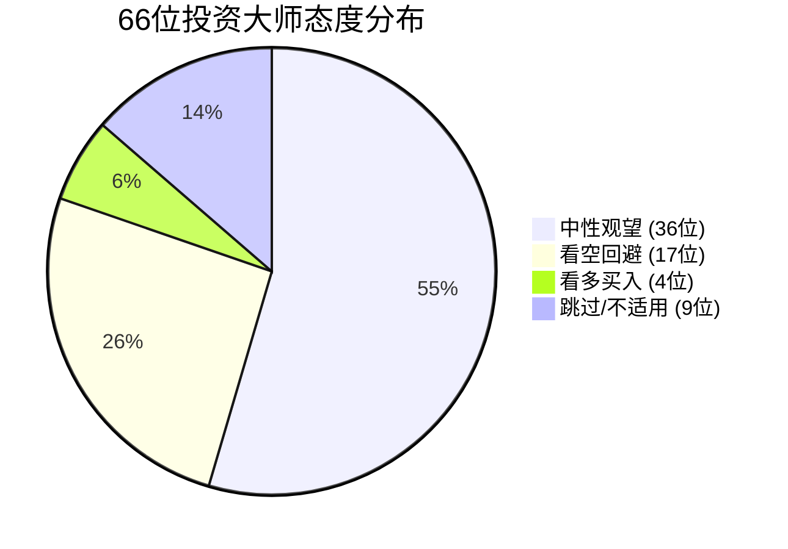
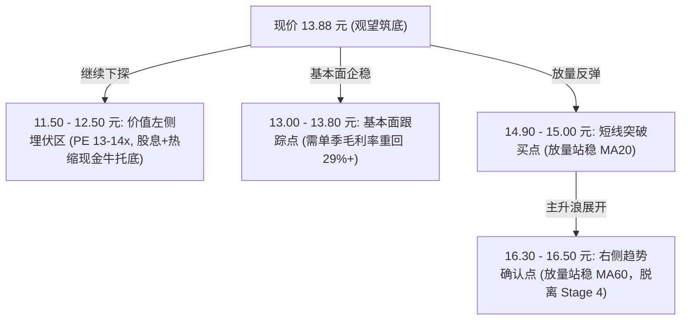

# 沃尔核材（002130.SZ / 09981.HK）深度分析与投资研判报告

> **报告基准日**：2026-11-14  
> **基准价格**：13.88 元（年内最高 33.18 元，最大回撤 -58.2%）｜ 市值：194.3 亿元 ｜ PE(TTM)：16.6 倍 ｜ PB：2.04 倍  
> **分析引擎**：UZI-Skill v3.9.4 深度分析系统（22 维基本面/量化数据 + 66 位跨流派投资评委团全量 Role-Play + 首席分析师研判）  
> **综合评分**：**54.3 / 100 · 观望偏空**（基本面得分 60.6，评委共识 44.9）  
> **杀猪盘评级**：🟢 **9/10 分（安全）**，无质押爆仓风险与虚假陈述  
> **HTML 交互报告**：[沃尔核材_002130_20261114.html](file:///H:/00_ai_projects/stock_analysis/沃尔核材_002130_20261114.html) ｜ 独立离线报告：[full-report-standalone.html](file:///H:/00_ai_projects/stock_analysis/UZI-Skill/skills/deep-analysis/scripts/reports/002130.SZ_20261114/full-report-standalone.html)

---

## Executive Summary · 核心结论

沃尔核材当前经历的本质是一次**“估值锚被砸（H股折价36.6%发行）+ 毛利被铜价侵蚀（单季降至27.98%）+ 增速换挡（前三季净利仅增6.77%）”的三重杀估值**，而非商业模式崩溃。

当前股价回落至 13.88 元（对应 PB 2.04 倍、近 5 年 25% 分位），已充分计提了赛道退潮与短期盈利受损预期。热缩材料（国内市占率 58.5%）的现金牛属性与高速铜缆（全球份额 24.9%、世界第二）的产业卡位构筑了公司的中长期底盘。但在毛利率止跌与右侧放量突破之前，**策略上“可蹲不可追，左侧耐心设伏，右侧等待信号”**。

---

## 一、 核心财务与基本面解剖

### 1. 增收不增利背后的两大“出血点”
- **2026 前三季度数据**：营业收入 74.41 亿元（同比 **+22.34%**），归母净利润 8.77 亿元（同比 **+6.77%**）。
- **Q3 单季数据**：营收 27.88 亿元（同比 +30.46%），归母净利 3.11 亿元（同比 +17.84%，但**环比 -7.33%**）。
- **毛利率持续失守**：2025 全年综合毛利率 31.65% → 2026 上半年 29.41% → 2026 Q3 **27.98%**（同比下滑 3.40 个百分点）。
- **归因剖析**：
  1. **原料成本飙升**：铜占通信线缆营业成本近 90%、占公司综合营业成本逾 12%。铜精矿 TC 加工费跌入负区间，铜价高位震荡，公司将套保额度上调至 3 亿元以对冲波动，但成本传导存在 1-2 季度滞后；
  2. **新产能爬坡折旧**：25 亿元扩产计划投产推进，固定折旧增加，而高端产能稼动率尚未满载，短期拖累毛利率。

### 2. 双主业护城河定位
- **热缩材料（国内垄断级现金牛）**：国内市占率 **58.5%**（CR4 达 76.6%，第二名泰科电子仅 11.1%），全球份额 **20.6%**。毛利率近 40%，经营性现金流极度充裕，为高速线业务提供“输血机”。
- **高速铜缆（AI 服务器/机柜世界第二）**：全球市场份额 **24.9%**，深度卡位安费诺、莫仕、泰科、立讯精密等 Tier 1 客户，供应主流 NVL72 机架直连；448G 部分规格样品已达标并小批量试产。

---

## 二、 估值重构：机械 DCF vs 机构现实

| 估值模型 | 每股公允估值 | 较现价 13.88 元溢价 | 核心假设与评价 |
|---|---|---|---|
| **机械 DCF 模型（乐观低折现）** | **22.85 元** | **+64.6%** | WACC=6.96%（无风险利率 2.5%、Beta=1.0），折现率过低，虚增了安全边际 |
| **机构审慎修正 DCF** | **15.45 元** | **+11.3%** | 将 WACC 调至更合理的 **9.0%**，安全边际收窄至 11%，现价并未深度超跌 |
| **华泰证券目标价** | **17.91 元** | **+29.0%** | 基于 2027 年预期净利润 20.6 亿元、给予 15 倍 PE 估值中枢 |
| **历史 PB 估值分位** | 2.04 倍 | 处于近 5 年 25% 分位 | 跌破 2 倍 PB 具备较强历史估值支撑 |

**分析师内在价值区间**：合理价值中枢在 **15.00 - 18.00 元**。

---

## 三、 66 位投资大师评委团全景研判

### 1. 流派共识得分对比
- **中式价投派（69.1分 · 买入）**：**全场最看多**。邓晓峰（70分）、朱少醒（68分）、冯柳（68分）认为热缩主业市占率近 60% 构筑高防护，市场将周期性成本压制误读为长期衰退，跌近 60% 后预期差巨大。
- **宏观派（49.1分 · 谨慎）**：达利欧（52分）、马克斯（50分）认为降息周期下制造业承压但已步入周期后半段；查诺斯（28分看空）指出毛利拐点未确立前不宜过早乐观。
- **经典价值派（48.1分 · 谨慎）**：巴菲特（56分）认可 ROE 连续多年维持在 15-19% 且负债率低（38.8%），但指出面对下游巨头缺乏定价权，护城河不足 24 分；格雷厄姆（38分）指出 PE×PB=33.9 远超 22.5 铁律；芒格（35分）警惕铜加工本质。
- **AI 卡位猎手派（46.1分 · 谨慎）**：Serenity（40分）认为柜内铜缆在 NVL72 等单机架具备 2-3 年高确定性，但面临 2028 年后 CPO 技术渗透的长线天花板。
- **游资派（41.0分 · 谨慎）**：30 个交易日上榜 0 次，成交缩量至 2-3 亿，日内无连板结构，缺乏短线资金合力。
- **成长派（31.9分 · 回避）**：欧奈尔（30分）指出 CANSLIM 中净利增速断档（6.77% 未达 25% 标准）；木头姐（32分）认为非平台颠覆性技术。
- **技术派（9.5分 · 极度回避）**：利弗莫尔（22分）、Minervini（30分）判定处于 Stage 4 下跌趋势，均线空头排列，严禁逆势接飞刀。

---

## 四、 首席分析师多空大碰撞

### 🟢 看多核心逻辑 (Top 3)
1. **产业硬实力无可替代**：全球高速铜缆份额 24.9%（第二名），客户直通安费诺与英伟达链，448G 工艺已小批量试产；国内热缩材料 58.5% 绝对垄断，主业每年提供数亿元稳定现金流。
2. **极端悲观定价已包含主要利空**：股价自 33.18 元腰斩至 13.88 元（-58.2%），PB 退守 2.04 倍（25% 历史分位），机械 DCF 显示估值下行空间已被估值底锁定。
3. **管理层积极对冲与价差修复**：将期货套期保值额度由 2 亿提高至 3 亿元锁铜价；港股 H 股持续推进股份回购注销，减轻两地折价摊薄。

### 🔴 看空核心逻辑 (Top 3)
1. **毛利率连降与增收不增利**：铜精矿加工费维持极低水平，铜价中枢居高不下，三季度综合毛利率已降至 27.98%（-3.4 pct），增收 22% 却只换来净利增 6.7%，成本消化仍需时日。
2. **高端扩产处于折旧与稼动率夹角**：25 亿产能投资下线，但初期稼动率未饱和，单位折旧推高，短期利润弹性承压。
3. **资金面离场与技术面 Stage 4**：2026Q3 持仓机构缩减至 8 家，龙虎榜 30 日 0 次上榜，股价受制于 MA20 与 MA60，缺乏增量资金推动右侧反转。

---

## 五、 操作区间与跟踪触发点

### 1. 交易风格与建仓区间
- **价值派左侧设伏位（11.50 - 12.50 元）**：对应 2026 年 PE 约 13-14 倍、PB 约 1.7 倍，股息与现金牛业务提供坚实下限保护。
- **基本面跟踪观察位（13.00 - 13.80 元）**：不急于抄底，需持续跟踪 4Q26/1Q27 单季毛利率能否环比止跌回升至 29% 以上。
- **短线交易博弈点（14.90 - 15.00 元）**：放量长阳有效突破 20 日均线压制。
- **右侧趋势确立点（16.30 - 16.50 元）**：放量站上 60 日均线并回踩确认，宣告彻底脱离 Stage 4 寻底结构。

### 2. 后续关键观察指标
1. **毛利率拐点**：四季度单季毛利率是否止跌回升（关键门槛 29.0%）；
2. **套保实效**：3 亿元套期保值执行后，能否明显平滑铜采购成本波动；
3. **448G 商用验证**：下一代高速铜缆客户认证与批量供货进展；
4. **H 股回购进度**：09981.HK 港股回购额度及 A/H 溢价率缩窄幅度。

---
*(报告由 UZI-Skill 深度分析系统根据公开披露财报与研报建模生成，仅供参考，不作为直接投资建议。)*
